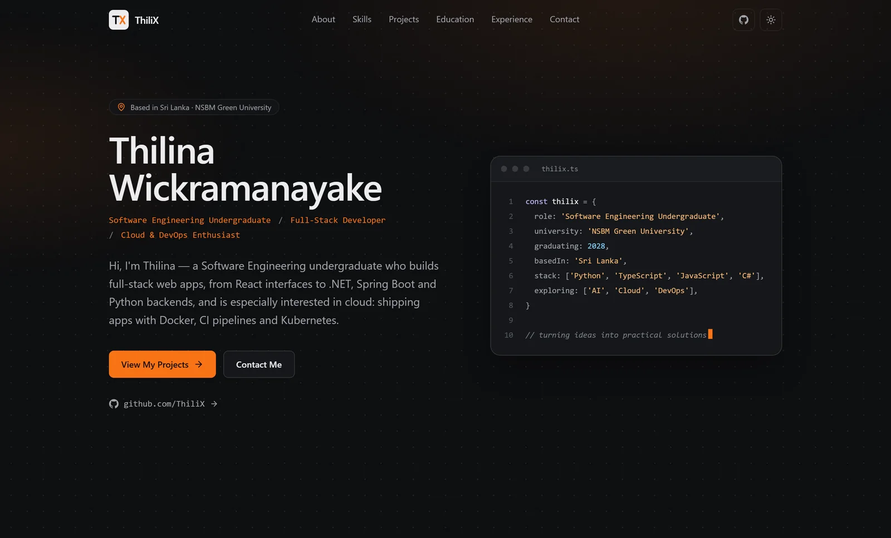

<div align="center">

# Thilina Wickramanayake · Portfolio

**Software Engineering Undergraduate · Full-Stack Developer · Cloud & DevOps Enthusiast**

[](https://thilix.github.io/)
[](https://www.linkedin.com/in/thilix/)
[](mailto:wickramanayakethilina95@gmail.com)

[](https://github.com/ThiliX/ThiliX.github.io/actions/workflows/deploy.yml)

<a href="https://thilix.github.io/"></a>

</div>

## About me

I'm a Software Engineering undergraduate at **NSBM Green University**, Sri Lanka (graduating 2028). I build full-stack web applications, from **React + TypeScript** interfaces to **C#/.NET**, **Java/Spring Boot** and **Python** backends, and I'm especially interested in **cloud and DevOps**: Docker, CI/CD pipelines and Kubernetes.

This repository is the source of my portfolio site, which I designed, built and deploy myself.

### Featured projects on the site

| Project | Highlights |
|---|---|
| [**PulseWatch**](https://github.com/ThiliX/pulsewatch) | Self-hostable API monitoring with incidents, email alerts, uptime/p95 dashboards and four-layer SSRF protection. .NET, PostgreSQL, React, Docker. |
| [**Servora**](https://github.com/ThiliX/Servora) | Multi-tenant AI customer-support platform: cited answers from each business's documents, PostgreSQL Row-Level Security isolation and race-free AI-to-human handoff. Spring Boot, FastAPI, pgvector, React. |
| [**TalentIQ**](https://github.com/TalentIq-team/talentIQ) | AI-assisted recruitment platform (team of 6). I owned the AI module: Gemini résumé matching, fallback scoring and the screening UI. |
| [**ThiliX's Portfolio XP**](https://github.com/ThiliX/Retro-Computer) | Portfolio that boots like an early-2000s PC: log-on screen, draggable windows, Start menu and built-in apps (terminal, Paint, synth, AI chat), built with React. [▶ Live demo](https://thilix.github.io/Retro-Computer/) |
| [**DevOps Pipeline Practical**](https://github.com/ThiliX/devops-practical) | Flask app through CI, Docker Hub, Kubernetes (2 replicas) and a self-healing chaos test. |

---

## How the site is built

| Area | Details |
|---|---|
| **Stack** | React 18 · TypeScript (strict) · Vite 6 · Tailwind CSS v4 · Lucide icons |
| **Hosting** | GitHub Pages, deployed by a GitHub Actions workflow on every push to `main` |
| **Content** | All text, projects and skills live in typed data files under `src/data/`, separate from the UI |
| **Performance** | No UI or animation framework; ~64 KB of gzipped JavaScript; lazy-loaded WebP images |
| **Accessibility** | Semantic sections, skip-to-content link, keyboard-friendly navigation, visible focus states, `prefers-reduced-motion` support |
| **SEO & sharing** | Meta and Open Graph tags, a social preview image, JSON-LD `Person` data, and a `robots.txt` and `sitemap.xml` generated at build time |
| **Extras** | Light/dark theme with no flash on load, interactive dot-field background, technology filter for projects, custom 404 page |

---

## Running it locally

Requires Node.js 20+.

```bash
npm install        # install dependencies
npm run dev        # dev server at http://localhost:5173
npm run typecheck  # TypeScript check only
npm run build      # type-check + production build into dist/
npm run preview    # serve the production build
```

### Project structure

```
├── index.html               # SEO / Open Graph / JSON-LD; %SITE_URL% is filled in at build time
├── 404.html                 # Custom 404 page
├── vite.config.ts           # Base path + generated robots.txt and sitemap.xml
├── .github/workflows/       # GitHub Pages deployment
├── docs/                    # Images used by this README (not deployed)
├── public/                  # Favicon, portrait, social preview, project screenshots
└── src/
    ├── data/                # ← all content: profile, skills, projects, experience, navigation
    ├── sections/            # One component per page section (Hero, About, Skills, Projects, …)
    ├── components/          # Reusable UI: Navbar, ProjectCard, ContactForm, DotField, …
    ├── hooks/               # useTheme, useActiveSection
    ├── lib/asset.ts         # Resolves /public files against the base path
    └── main.tsx             # Shows the portfolio on "/" and the 404 page elsewhere
```

### Updating content

Edit the files in `src/data/`; components rarely need to change.

- **`profile.ts`**: intro, About text, roles, links, `photo`, `cvUrl` (put a PDF in `public/` to show a **Download CV** button) and `formEndpoint` (optional, e.g. Formspree; without it the contact form opens the visitor's email app).
- **`projects.ts`**: one object per project. `featured: true` makes a large card. Screenshots go in `public/projects/` (16:10, e.g. 1600×1000 WebP), referenced without a leading slash. Empty `features` or `tech` lists are hidden.
- **`skills.ts`**: skill categories. Icons: `code`, `layout`, `server`, `database`, `tools`, `cloud`, `brain`, `mobile`.
- **`experience.ts`**: education and workshops.
- **Colours**: tokens at the top of `src/index.css` (`--accent` for the orange).

---

## Deployment

`.github/workflows/deploy.yml` builds and publishes the site to GitHub Pages on every push to `main` (Pages source: **GitHub Actions**). It sets the base path and public URL from the repository name automatically:

| Repository name | Site URL |
|---|---|
| `ThiliX.github.io` (this repo) | `https://thilix.github.io/` |
| any other name, e.g. `portfolio` | `https://thilix.github.io/portfolio/` |

**Custom domain (optional):** add a repository variable `CUSTOM_DOMAIN` (e.g. `example.com`) and set the domain in **Settings → Pages**. The workflow then builds for that domain and writes the `CNAME` file.

---

<div align="center">

© Thilina Wickramanayake · [thilix.github.io](https://thilix.github.io/)

</div>
